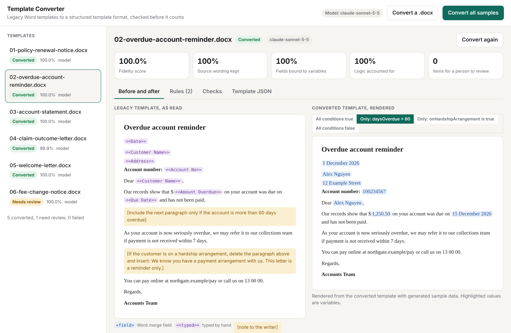
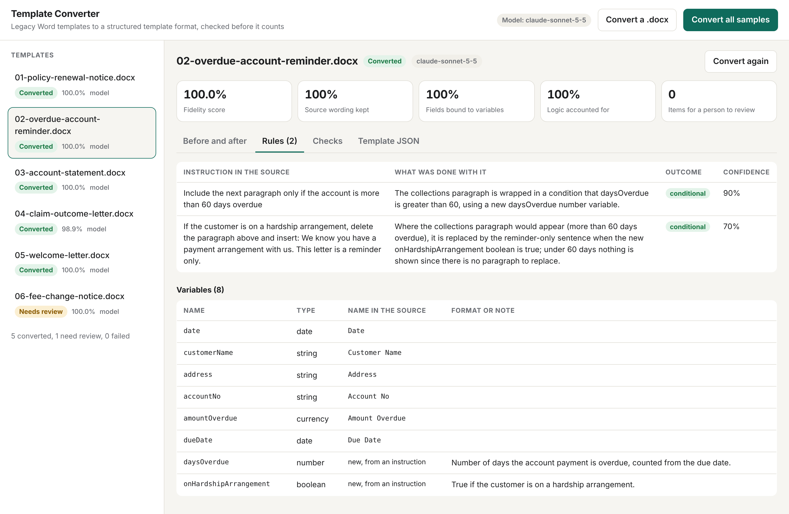
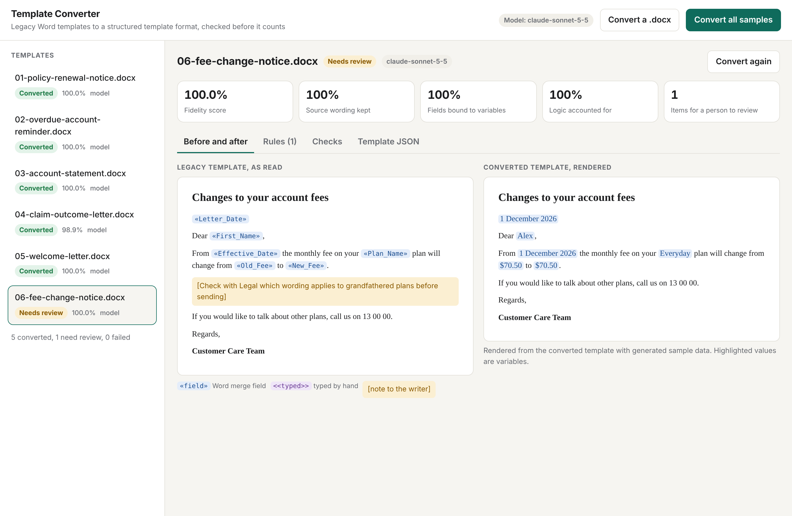

# Template Converter

A proof of concept for one problem: moving document templates out of a legacy system and into a new
platform's format without a person rebuilding each one by hand.

It reads a legacy Word template, converts it into a structured JSON template with an LLM, and then
refuses to call it converted until it passes a set of deterministic checks against the original.
Anything that needs a person's judgement goes to a review list instead of being guessed.

Written in C# on .NET 8. The engine has no third-party packages.

## Why it is built this way

Converting a template is mostly easy and occasionally very hard. Merge fields and IF fields are
mechanical. The hard part is everything that was never formal: placeholders typed by hand in four
different styles, and notes in the margin like "delete this section if the customer does not pay by
direct debit". Those notes are business rules, and they only exist as English.

So the work is split by who is good at what:

1. **Code reads the file.** An exact structural read, with nothing guessed.
2. **Rules convert what is unambiguous.** Real fields, IF fields, repeating rows.
3. **The model converts what is not.** It reads the written instructions and turns them into
   conditions, works out that `[Customer First Name]` and `{{first_name}}` are the same value, and
   picks names and types.
4. **Code marks the model's work.** The model never grades itself. Its answer is checked against the
   source, and if a check fails the errors go back to the model for another attempt.
5. **A person gets what is left.** If an instruction cannot be decided from the document alone, the
   template is flagged for review with the exact question to answer.

```
legacy .docx
    |
    v
 DocxReader ......... exact read: fields, IF logic, repeats, typed placeholders, instructions
    |
    v
 RuleMapper ......... deterministic draft (also the offline mode and the fallback)
    |
    v
 LlmMapper .......... model maps the draft to the target format        <----+
    |                                                                       |
    v                                                                       | errors
 Validator .......... wording, fields, logic, leftovers, render test  -----+ (up to 3 attempts)
    |
    v
 Converted  |  Needs review  |  Failed checks        + a report for every template
```

## What gets checked

| Check | Fails when |
| --- | --- |
| Structure | The template does not follow the target format, or uses a variable it never declared |
| Fields | A field in the source is not bound to a variable, or the variable is never used |
| Logic | An IF field has no matching condition, a repeating row has no repeat, or a written instruction is not accounted for |
| Leftovers | Placeholder syntax or an instruction to the writer would be printed to the customer |
| Wording | Source words are missing from the output, or the output contains words that were never in the source |
| Render | The template cannot produce a document from sample data down both sides of every condition |

Each result gets a fidelity score built from those checks, and a report listing every attempt, every
finding and every rule the model inferred, with its confidence.

## The sample set

Six made-up templates in `samples/legacy`, each written to stress a different part of the problem.
`tools/make_samples.py` builds them as raw WordprocessingML, so the field codes are the same ones
Word's mail merge writes.

| Template | What it tests |
| --- | --- |
| 01 policy renewal notice | Real merge fields with format switches, two IF fields, a merge field nested inside an IF, a footer with page fields |
| 02 overdue account reminder | Hand-typed `<<placeholders>>` and two written instructions, one of which replaces a paragraph |
| 03 account statement | A repeating table row (`TableStart` / `TableEnd`), a numeric IF, landscape page |
| 04 claim outcome letter | Three placeholder styles in one file and an either/or instruction ("use paragraph A if approved, B if declined") |
| 05 welcome letter | Typed chevrons, headings, a bullet list, a page break, an optional section |
| 06 fee change notice | An instruction no tool should decide ("check with Legal which wording applies"). The correct result is "needs review" |

## Results

The six samples, run on 18 November 2026. The outputs of the model run are in `samples/converted`.

| Template | Rule-based pass only | With the model step (claude-sonnet-5-5) | Fidelity | Model attempts |
| --- | --- | --- | --- | --- |
| 01 policy renewal notice | Converted | Converted | 100.0 | 1 |
| 02 overdue account reminder | Needs review (2 items) | Converted | 100.0 | 1 |
| 03 account statement | Converted | Converted | 100.0 | 1 |
| 04 claim outcome letter | Needs review (1 item) | Converted | 98.9 | 1 |
| 05 welcome letter | Needs review (1 item) | Converted | 100.0 | 1 |
| 06 fee change notice | Needs review (1 item) | Needs review (1 item) | 100.0 | 1 |

What the model did that rules could not:

- **02:** read two instructions and produced a nested condition. If the customer is on a hardship
  arrangement, print the arrangement wording from the instruction. Otherwise, if the account is more than
  60 days overdue, print the collections paragraph. It declared two new variables for values the legacy
  file never named.
- **04:** turned "use paragraph A if approved, B if declined" into one condition with an else branch and
  removed the "A." and "B." labels. That is the 98.9: the wording check reports the two dropped labels.
- **05:** wrapped a heading and its paragraph in a condition from "delete this section if the customer
  does not pay by direct debit".
- **06:** did not guess. It left the letter unchanged and flagged it with the question a reviewer has to
  answer.

Read these numbers for what they are. Six small templates I wrote myself, where the model passed every
check on its first attempt, in two runs out of two. The whole batch used about 24,000 input and 9,000
output tokens and took under 20 seconds at three at a time. The repair loop did not have to fire on this
set, so it is covered by tests that use a scripted stand-in for the model. Real legacy templates will be
messier than these.







## Run it

Needs the .NET 8 SDK.

```bash
# tests
dotnet run --project tests/Converter.Tests

# convert a folder from the command line
dotnet run --project src/Converter.Cli -- samples/legacy out

# web interface and HTTP API on http://localhost:5000
dotnet run --project src/Converter.Api
```

Set `ANTHROPIC_API_KEY` to turn on the model step (`ANTHROPIC_MODEL` to choose the model). Without a
key everything still runs on the rule-based pass, and written instructions are sent for review.

HTTP API:

| Call | Does |
| --- | --- |
| `POST /api/convert` | Converts the .docx in the request body. `X-File-Name` header carries its name |
| `POST /api/batch/samples` | Starts a batch over the sample set and returns a job id |
| `GET /api/jobs/{id}` | Batch progress |
| `GET /api/results/{name}` | Full result: source read, template, checks, attempts, renders |

## Layout

| Path | What is in it |
| --- | --- |
| `src/Converter.Core` | The engine: reader, rule mapper, model mapper, validator, renderer, pipeline |
| `src/Converter.Api` | ASP.NET Core host and the web interface |
| `src/Converter.Cli` | Batch command |
| `src/Converter.Functions` | Azure Functions host (isolated worker): an HTTP trigger, and a blob trigger that converts each uploaded template, writes the result to storage and queues anything that needs review |
| `tests/Converter.Tests` | Tests for the reader, validator and repair loop, using a scripted stand-in for the model |
| `docs/platform-template-format.md` | The target format |

## What this is not

- **It reads Word templates only.** Exports from CCM platforms such as Quadient Inspire or OpenText
  Exstream are proprietary formats and each would need its own reader. The reader is the only part that
  knows about the source format: everything after it works on the intermediate read.
- **The target format is a stand-in.** It is mine, not a real platform's. Pointing this at a real schema
  means changing the mapper prompt, the structure checks and the renderer.
- **The wording check compares words, not layout.** It proves nothing was lost or invented. It does not
  prove the page looks the same. A real migration would add a visual comparison of rendered output.
- **The Azure Functions project has not been deployed.** It builds, and it shares the engine with the
  API and the command line, but it has only been exercised through those two.
- **Batch state is in memory.** A SQL job table is the obvious next step.

## About

Built by Connor Temenes in November 2026, working with AI coding agents (Claude Code).
Every sample company, name and number in this repository is made up.
